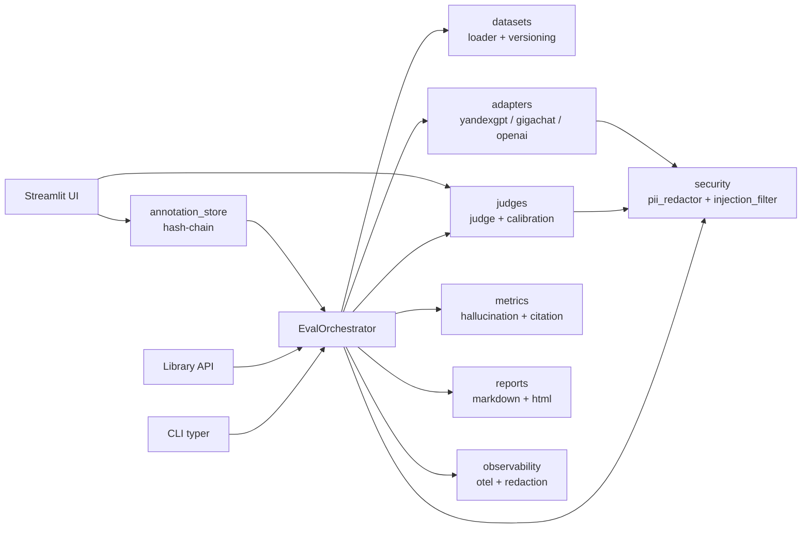

# regulated-llm-eval

> Eval-фреймворк для LLM в regulated-доменах (налоги, бухгалтерия, право).
> Калиброванный LLM-as-a-judge, метрики галлюцинаций и citation accuracy, A/B-тесты промптов, PII-redaction под 152-ФЗ, поддержка YandexGPT и GigaChat.

[](https://www.python.org/downloads/)
[](LICENSE)
[](https://pypi.org/project/regulated-eval/)
[](docs/PRD.md)

---

## Quickstart (≤ 5 минут)

### 1. Установка

```bash
pip install regulated-eval
```

> **Требования:** Python 3.11+

### 2. Опциональные зависимости

```bash
# PII-redaction (Presidio)
pip install "regulated-eval[presidio]"

# Streamlit UI для экспертов
pip install "regulated-eval[streamlit]"
```

### 3. API-ключ провайдера

```bash
# YandexGPT (российский, соответствует 152-ФЗ)
export YANDEXGPT_API_KEY="your-key"

# GigaChat (российский, соответствует 152-ФЗ)
export GIGACHAT_API_KEY="your-key"
```

### 4. Первый прогон

```bash
# Загрузка sample golden set (20 вопросов по УСН/НДС/взносам)
regulated-eval dataset load --path datasets/tax_qa_v1/sample.jsonl --version 0.1.0

# Прогон через YandexGPT + judge
regulated-eval run \
  --dataset tax_qa_v1@0.1.0 \
  --model yandexgpt \
  --judge-model yandexgpt \
  --report md

# Отчёт: reports/<run_id>.md
```

### 5. Калибровка (обязательно перед публикацией отчёта)

```bash
regulated-eval calibrate \
  --dataset calibration_v1 \
  --judge-model yandexgpt \
  --threshold 0.6
# → PASS (kappa ≥ 0.6) или FAIL + рекомендации
```

### 6. A/B-сравнение моделей

```bash
regulated-eval ab \
  --model-a yandexgpt \
  --model-b gigachat \
  --dataset tax_qa_v1@0.1.0 \
  --judge-model yandexgpt
```

## Что внутри

| Возможность | Что даёт |
|---|---|
| **Golden set management** | JSONL + Pydantic-схема, semver + content hash, воспроизводимость прогонов |
| **LLM-as-a-judge с калибровкой** | Score 1–5 + бинарные флаги (hallucination, wrong citation, incorrect refusal), Cohen's kappa с CI, repair-retry на невалидный JSON |
| **Метрики** | `hallucination_rate`, `citation_accuracy`, `refusal_correctness`, `factual_consistency`, агрегация по category/difficulty/model |
| **Human-in-the-loop** | Streamlit UI для экспертов, hash-цепочка аннотаций (защита от подмены), CLI для разрешения конфликтов |
| **A/B-тесты** | Bootstrap CI, Wilcoxon, Cohen's d, интерпретация `not_significant` |
| **Адаптеры LLM** | YandexGPT, GigaChat, OpenAI-compatible (с явным opt-in под 152-ФЗ) |
| **PII-redaction** | Presidio + кастомные regex для РФ (ИНН, СНИЛС, паспорт, телефон, адрес), audit-лог без значений |
| **Prompt-injection фильтр** | Allowlist доменов + эвристики для retrieved-документов (RAG) |
| **Observability** | OTel-инструментация (spans, metrics, audit-logs) с redaction-middleware, SLO: eval-run p95 ≤ 300s, judge p95 ≤ 5000ms |
| **Отчёты** | Markdown / HTML с метриками, top-N ошибок, delta между прогонами |
| **CLI + Library API** | Typer CLI и Python API — одинаковый функционал |

## Архитектура



## 152-ФЗ и foreign providers

По умолчанию разрешены **только российские провайдеры** (YandexGPT, GigaChat) — они соответствуют 152-ФЗ. Для OpenAI-compatible требуется **двойной opt-in**:

```bash
regulated-eval run \
  --dataset tax_qa_v1@0.1.0 \
  --model openai_compat \
  --allow-foreign-provider \
  --i-understand-152fz
```

Или через env (для CI, с предупреждением в stderr):

```bash
export REGULATED_EVAL_ALLOW_FOREIGN_PROVIDER=true
export REGULATED_EVAL_ACK_152FZ=true
```

Каждое разрешение фиксируется в audit-логе `provider.foreign.allowed`. Подробнее — в [`docs/152fz.md`](docs/152fz.md).

## Метрики качества

| Метрика | Как считается | Целевое значение |
|---|---|---|
| `judge.calibration.kappa` | Cohen's kappa (judge vs эксперт) | ≥ 0.6 |
| `hallucination_rate` | LLM-judge + экспертный сэмпл | ниже baseline на ≥ 50% |
| `citation_accuracy` | Точное/частичное совпадение + judge | ≥ 0.9 для regulated-домена |
| `refusal_correctness` | Бинарная классификация | ≥ 0.95 |
| `judge.parse_error.rate` | Доля невалидных JSON от judge | ≤ 5% |
| `eval.run.duration` p95 | Histogram | ≤ 300s (150 вопросов) |
| `llm.request.duration{role=judge}` p95 | Histogram | ≤ 5000ms |

Полная методология — в [`docs/methodology.md`](docs/methodology.md).

## Структура репозитория

```
regulated-llm-eval/
├── README.md                    # этот файл
├── proposal.md                  # OpenSpec: why / what / impact
├── context.md                   # Traceability Matrix, принятые ADR
├── specs/eval-pipeline/spec.md  # FR/NFR + Observability Contract
├── design/design.md             # архитектура, потоки, точки инструментирования
├── threat-model/threat-model.md # STRIDE + OWASP LLM, 15 угроз, 9 Trust Boundaries
├── adr/                         # 5 ADR (PII, allowlist, judge, OTel, hash-chain)
├── api/api-contract.yaml        # CLI + Library API + JSON Schema
├── test-specs/eval-pipeline/tests.md  # 64 теста, coverage matrix
├── tasks/tasks.md               # 96 задач, ~191 SP
├── apply/apply.md               # миграции, feature flags, observability verification
├── docs/
│   ├── PRD.md
│   ├── methodology.md
│   ├── case_study.md
│   └── 152fz.md
├── scripts/                     # PowerShell-скрипты для генерации артефактов
├── datasets/
│   ├── tax_qa_v1/
│   └── calibration_v1/
└── src/regulated_eval/          # (реализация — по tasks.md)
```

## Разработка

### Требования

- Python 3.11+
- Git

### Установка для разработки

```bash
git clone https://github.com/realrvs/regulated-llm-eval-framework.git
cd regulated-llm-eval-framework

python -m venv .venv
source .venv/bin/activate  # Windows: .venv\Scripts\activate

pip install -e ".[dev]"
```

### Тесты

```bash
pytest --cov=regulated_eval --cov-report=term-missing
# Целевое покрытие: ≥ 80% для judges, metrics, ab, datasets
```

### Линтеры

```bash
ruff check .
mypy src/regulated_eval
```

## Roadmap

- [x] OpenSpec pipeline (proposal → specs → design → threat-model → adr → api-contract → test-specs → tasks → apply)
- [x] MVP implementation (Foundation, Datasets, Adapters, Security, Judges, Metrics, Pipeline, Reports)
- [x] Phase 6-10: Human-loop, A/B, Reports, Observability, Pipeline
- [ ] Phase 11: Tests (T-1101..T-1114)
- [ ] Phase 12: CI (T-1201..T-1205)
- [ ] Phase 13: Docs (T-1301..T-1305)
- [ ] Phase 14: Apply (T-1401..T-1403)
- [x] v1.0.0 release (TestPyPI)

Полный план — в [`tasks/tasks.md`](tasks/tasks.md).

## Contributing

1. Fork → branch → PR.
2. Убедитесь, что `pytest --cov` ≥ 80% и `ruff check` / `mypy` зелёные.
3. Для security-изменений — обновите `threat-model.md` и добавьте тест с `TM Ref`.
4. Для observability-изменений — обновите Observability Contract в `spec.md` и `test-specs`.

## License

MIT — см. [LICENSE](LICENSE).

## Security

See [SECURITY.md](SECURITY.md) for reporting vulnerabilities.
