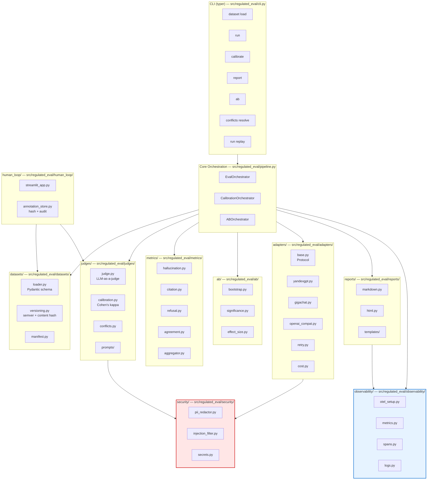
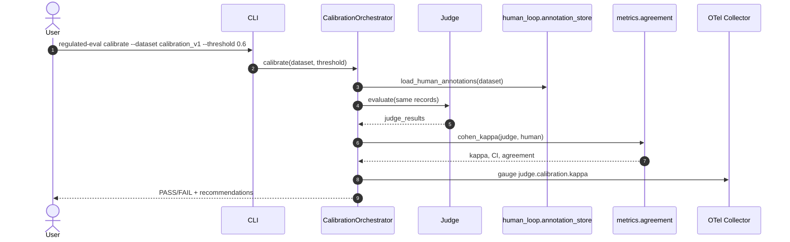
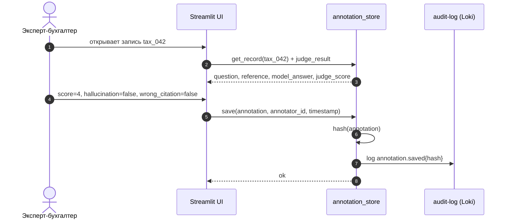

# Design: Regulated LLM Eval Framework

## Context

Eval-фреймворк для LLM в regulated-домене (налоги, бухгалтерия, право). Ключевое ограничение — **высокая цена ошибки**: галлюцинация в ответе про налоговый вычет приводит к финансовым потерям клиента и регуляторным последствиям (152-ФЗ). Поэтому eval — не «постфактум», а **артефакт проектирования**: сигналы (logs/metrics/traces) фиксируются на этапе spec, детализируются здесь, защищаются в threat-model и проверяются в test-specs.

Система — CLI + Python-библиотека (`regulated-eval`), работающая локально/в CI. Внешние зависимости: LLM-провайдеры (YandexGPT, GigaChat, OpenAI-compatible), OTel Collector → Prometheus/Loki/Jaeger/Grafana. Golden set и экспертные аннотации — файловые (JSONL), версионируются semver + content hash.

Domain: `data-pipeline`. Ограничения: Python 3.11+, MIT, без платформо-специфичных зависимостей (NFR-006), покрытие тестами ≥ 80% (NFR-009).

## Goals / Non-Goals

**Goals:**
- Единый пайплайн: load → run → judge → calibrate → metrics → report → ab.
- Калиброванный LLM-as-a-judge (Cohen's kappa ≥ 0.6) с human-in-the-loop разрешением конфликтов.
- Адаптеры YandexGPT/GigaChat/OpenAI-compatible с retry, rate-limit, cost tracking.
- PII-redaction до LLM (152-ФЗ) + prompt-injection фильтр retrieved-документов.
- Воспроизводимость прогонов (manifest + replay) с детерминизмом ± 1%.
- OTel-инструментация всех runtime-путей; SLO: eval-run p95 ≤ 300s, judge p95 ≤ 5000ms, availability ≥ 99.0%.
- CLI (`typer`) и библиотечный API — одинаковый функционал.

**Non-Goals:**
- Обучение/файнтюнинг моделей.
- Полноценный веб-дашборд (только Streamlit для разметки + Markdown/HTML-отчёты).
- Продакшн-мониторинг LLM-продуктов (это отдельная система).
- Юридическая экспертиза эталонных ответов (ответственность эксперта-бухгалтера).
- Мультитенантность / RBAC (v1 — single-user CLI).

## Decisions

### Компонентная архитектура



### Потоки данных

#### Поток 1: Eval run (основной)

```mermaid
sequenceDiagram
    autonumber
    actor User
    participant CLI
    participant Orchestrator as EvalOrchestrator
    participant DS as datasets.loader
    participant Sec as security.pii_redactor
    participant Adapter as adapters.yandexgpt
    participant Judge as judges.judge
    participant Metrics as metrics.aggregator
    participant Reports as reports.markdown
    participant OTel as OTel Collector

    User->>CLI: regulated-eval run --dataset tax_qa_v1@1.2.0 --model yandexgpt
    CLI->>Orchestrator: run(dataset, model, seed)
    Orchestrator->>OTel: start span eval.run
    Orchestrator->>DS: load(version, content_hash)
    DS-->>Orchestrator: records[], manifest

    loop по каждому record (parallelism=8)
        Orchestrator->>Sec: redact_pii(record.question)
        Sec->>OTel: log security.pii.redacted{field.name}
        Sec-->>Orchestrator: redacted_prompt
        Orchestrator->>Adapter: generate(redacted_prompt)
        Adapter->>OTel: metric llm.request.duration{role="generator"}
        Adapter->>OTel: span adapter.call
        Adapter-->>Orchestrator: model_answer
        Orchestrator->>Judge: evaluate(question, reference, model_answer, citations)
        Judge->>OTel: span judge.evaluate
        Judge->>OTel: metric llm.request.duration{role="judge"}
        Judge-->>Orchestrator: score, flags, rationale
    end

    Orchestrator->>Metrics: aggregate(judge_results)
    Metrics->>OTel: gauge hallucination.rate, citation_accuracy
    Orchestrator->>Reports: render(run_result, format=md)
    Reports-->>User: reports/{run_id}.md
    Orchestrator->>OTel: end span eval.run; metric eval.run.duration
```

#### Поток 2: Calibration



#### Поток 3: Human-in-the-loop annotation



### Технологический стек

| Слой | Технология | Обоснование |
|---|---|---|
| Язык | Python 3.11+ | NFR-006 (portability), зрелая AI/ML-экосистема |
| CLI | Typer | Типизированный, автогенерация `--help`, совместим с библиотечным API (FR-014) |
| Схемы | Pydantic v2 | Валидация golden set (FR-001), сериализация манифеста (FR-012) |
| Data | pandas | Агрегации метрик (FR-006), экспорт в Markdown |
| Статистика | scikit-learn (Cohen's kappa), SciPy (Wilcoxon) | Калибровка (FR-005), A/B (FR-008) |
| Bootstrap | numpy + собственная реализация | Контроль над seed и CI (NFR-005) |
| Шаблоны | Jinja2 | Markdown/HTML-отчёты (FR-009) |
| Разметка | Streamlit | Быстрый UI для экспертов (FR-007), без фронтенд-стека |
| LLM-адаптеры | httpx + tenacity | Retry/backoff (FR-003, NFR-008) |
| PII | presidio + кастомные regex для РФ (ИНН/СНИЛС/паспорт) | 152-ФЗ (NFR-SEC-002) |
| Injection | allowlist + эвристики (regex + LLM-проверка при сомнении) | NFR-SEC-003 |
| Secrets | pydantic-settings + env | NFR-SEC-004 |
| OTel | opentelemetry-sdk + opentelemetry-exporter-otlp | NFR-OBS (см. ниже) |
| Тесты | pytest + pytest-cov + pytest-asyncio | NFR-009 |
| CI | GitHub Actions | NFR-009 |
| Пакетирование | hatchling + `pyproject.toml` | Современный стандарт, MIT |

### Точки инструментирования

> На основе Observability Contract из `spec.md`.

| Сигнал | Где создаётся (файл/класс) | Тип | Auto/Manual | Атрибуты |
|--------|---------------------------|-----|-------------|----------|
| `eval.run.duration` | `pipeline.py::EvalOrchestrator.run` (конец) | metric (histogram) | manual | `dataset.version`, `model.provider`, `model.name`, `run.id`, `trace_id` |
| `eval.run.failed` | `pipeline.py::EvalOrchestrator.run` (except) | metric (counter) | manual | `run.id`, `error.reason`, `trace_id` |
| `llm.request.duration` | `adapters/base.py::BaseAdapter.generate` (finally) | metric (histogram) | manual | `llm.provider`, `llm.model`, `llm.role`, `trace_id` |
| `judge.calibration.kappa` | `judges/calibration.py::compute_kappa` | metric (gauge) | manual | `dataset.version`, `judge.model`, `trace_id` |
| `hallucination.rate` | `metrics/aggregator.py::aggregate` | metric (gauge) | manual | `dataset.version`, `model.name`, `category`, `trace_id` |
| `citation_accuracy` | `metrics/aggregator.py::aggregate` | metric (gauge) | manual | `dataset.version`, `model.name`, `trace_id` |
| `eval.run` | `pipeline.py::EvalOrchestrator.run` | span | manual | `run.id`, `dataset.version`, `model.name`, `trace_id` |
| `judge.evaluate` | `judges/judge.py::Judge.evaluate` | span | manual | `record.id`, `judge.model`, `judge.prompt.version`, `trace_id` |
| `adapter.call` | `adapters/base.py::BaseAdapter.generate` | span | manual | `llm.provider`, `llm.model`, `trace_id` |
| `security.pii.redacted` | `security/pii_redactor.py::redact` | log (audit) | manual | `field.name`, `run.id`, `trace_id` — **без значений** |
| `injection.suspected` | `security/injection_filter.py::check` | log (audit) | manual | `source`, `run.id`, `trace_id` — **без содержимого документа** |
| `judge.conflict.resolved` | `judges/conflicts.py::resolve` | log (structured) | manual | `record.id`, `resolution`, `annotator.id`, `trace_id` |
| `ab.test.completed` | `ab/__init__.py::run_ab` (конец) | log (structured) | manual | `prompt.a`, `prompt.b`, `delta`, `p_value`, `trace_id` |

**Auto-instrumentation:** `opentelemetry-instrumentation-httpx` — для исходящих HTTP-вызовов к LLM-провайдерам (спаны `HTTP CLIENT`), но **бизнес-атрибуты** (`llm.provider`, `llm.role`) добавляются вручную через `span.set_attribute` в адаптере.

### Проброс корреляции

- **W3C `traceparent`:** CLI генерирует root span `eval.run` при старте. При параллельных вызовах адаптеров каждый получает `traceparent` через `opentelemetry.context.attach(ctx)` в worker-потоке/таске. HTTP-клиент (`httpx`) с `OpenTelemetryInstrumentation` автоматически инжектит `traceparent` в заголовки запросов к YandexGPT/GigaChat/OpenAI.
- **`X-Request-ID`:** генерируется на уровне CLI (`uuid4`), сохраняется в `run.id`, попадает во все логи и в манифест. Для library API — параметр `run_id: str | None`, если не задан — генерируется.
- **Service A → Service B:** внутри одного процесса — через OTel context; между процессами (например, Streamlit UI → annotation_store) — через `traceparent`, передаваемый в HTTP-заголовке (Streamlit вызывает внутренний API-эндпоинт store) или через `run.id` в файловых артефактах.
- **Логи → трейсы:** каждая audit-запись (`security.pii.redacted`, `injection.suspected`, `judge.conflict.resolved`) содержит `trace_id`, что позволяет в Loki найти лог, а в Jaeger — соответствующий трейс.

### Ключевые решения по безопасности (вход в threat-model)

1. **PII-redaction перед LLM** — `security/pii_redactor.py::redact(text) -> (redacted_text, redacted_fields[])`. Редактирует: ФИО, ИНН (10/12 цифр), СНИЛС, паспорт (серия/номер), телефон, email, адрес. Возвращает только имена полей для audit-лога. **Никогда не передаёт исходный текст в LLM.**
2. **Provider allowlist** — `security/secrets.py::is_provider_allowed(provider, allow_foreign: bool)`. По умолчанию: `yandexgpt`, `gigachat` — разрешены; `openai_compat` — только при `--allow-foreign-provider`. Нарушение → `ForeignProviderNotAllowed` (NFR-SEC-001).
3. **Prompt-injection фильтр retrieved-документов** — `security/injection_filter.py::check(doc) -> (allowed, reason)`. Allowlist доменов (`minfin.gov.ru`, `nalog.gov.ru`, `pravo.gov.ru`, `consultant.ru` — конфигурируемо) + эвристики («ignore previous instructions», «reveal system prompt», «you are now», base64-полезная нагрузка). При сомнении — LLM-проверка (не передаёт PII, т.к. документ уже прошёл PII-фильтр). Блокировка → `injection.suspected` + `context_blocked=true` (NFR-SEC-003).
4. **Secrets management** — `security/secrets.py::get_api_key(provider)` читает только из env (`YANDEXGPT_API_KEY`, `GIGACHAT_API_KEY`, `OPENAI_API_KEY`). В логах — маска `***`. В манифест не попадает. Ошибка при отсутствии → `MissingCredentials` (NFR-SEC-004).
5. **Целостность аннотаций** — `human_loop/annotation_store.py::save` считает `sha256(annotation + annotator_id + timestamp + prev_hash)` (цепочка хешей), audit-лог неизменяем. Попытка изменить без audit-записи → `annotation.tamper` (NFR-SEC-005).

> Детализация угроз, Trust Boundaries и Top-3 угроз — в `threat-model/threat-model.md` (следующий артефакт).

### Схема данных (упрощённо)

**Golden set record (Pydantic):**

```python
class GoldenRecord(BaseModel):
    id: str
    question: str
    reference_answer: str
    citations: list[str]
    category: Literal["УСН", "НДС", "взносы", "НДФЛ", "прочее"]
    difficulty: Literal["easy", "medium", "hard"]
    expert_validated: bool
```

**Judge result:**

```python
class JudgeResult(BaseModel):
    record_id: str
    score: int  # 1..5
    hallucination: bool
    wrong_citation: bool
    incorrect_refusal: bool
    rationale: str
    judge_model: str
    judge_prompt_version: str
    trace_id: str
```

**Run manifest:**

```python
class RunManifest(BaseModel):
    run_id: str
    timestamp: datetime
    dataset_version: str
    dataset_content_hash: str
    model_provider: str
    model_name: str
    judge_model: str
    judge_prompt_version: str
    seed: int
    package_version: str
    tokens_input: int
    tokens_output: int
    estimated_cost_rub: float | None
    trace_id: str
```

### Структура репозитория (целевая)

```text
src/regulated_eval/
├── cli.py
├── pipeline.py
├── datasets/{loader,versioning,manifest}.py
├── judges/{judge,calibration,conflicts}.py + prompts/
├── metrics/{hallucination,citation,refusal,agreement,aggregator}.py
├── human_loop/{streamlit_app,annotation_store}.py
├── ab/{bootstrap,significance,effect_size}.py
├── adapters/{base,yandexgpt,gigachat,openai_compat,retry,cost}.py
├── reports/{markdown,html}.py + templates/
├── security/{pii_redactor,injection_filter,secrets}.py
└── observability/{otel_setup,metrics,spans,logs}.py
```

## Risks / Trade-offs

- **Риск:** LLM-провайдеры нестабильны (rate-limit, деградация) → метрики прогона неполные. **Митигация:** retry + exponential backoff (NFR-008), пометка `rate_limited` в отчёте, `degraded`-статус при > 20% rate-limit, alert `rate_limit.high`.
- **Риск:** PII-фильтр пропускает PII (ложноотрицательный) → нарушение 152-ФЗ. **Митигация:** комбинация presidio + кастомные regex для РФ; тест TC-SEC-002 с 100 записями, требование ≥ 99% recall; при провале — релиз блокируется.
- **Риск:** Judge не калибруется до kappa ≥ 0.6 → eval-результаты недостоверны. **Митигация:** обязательная калибровка перед публикацией отчёта; при FAIL — рекомендации (few-shot, CoT, разбить на бинарные подзадачи); порог конфигурируем.
- **Риск:** Воспроизводимость нарушается из-за недетерминизма LLM (temperature > 0). **Митигация:** фиксированный seed, temperature=0 для judge, replay-тест с допуском ± 1% (NFR-005); расхождения > 1% → `non_deterministic`.
- **Риск:** Streamlit UI не масштабируется на 100+ экспертов. **Митигация:** v1 — single-user (эксперт запускает локально); мультитенантность — non-goal.
- **Trade-off:** CLI-first, без веб-дашборда → ниже «продуктовый» UX, но быстрее time-to-market и проще в CI. Отчёты в Markdown/HTML компенсируют.
- **Trade-off:** Open-source (MIT) → нельзя монетизировать сам фреймворк, но это инструмент для портфолио и для внутреннего использования в «Моё Дело».

## Migration Plan

Проект новый (greenfield), миграций данных нет. Порядок реализации — см. `tasks/tasks.md`:

1. Фундамент: пакет, Pydantic-схемы, CLI-скелет, OTel-инициализация.
2. datasets: loader, versioning, manifest.
3. adapters: base + yandexgpt + retry + cost.
4. security: pii_redactor, injection_filter, secrets.
5. judges: judge, calibration, conflicts.
6. metrics: агрегаторы + Cohen's kappa.
7. human_loop: Streamlit UI + annotation_store.
8. ab: bootstrap, significance, effect_size.
9. reports: Markdown/HTML.
10. Observability: метрики, спаны, дашборд, алерты.
11. Тесты (unit/integration/e2e/security/observability) + CI.
12. Документация (README, methodology.md, PRD.md, case_study.md).

## Open Questions

- [ ] Порог `expert_validated` в golden set v1: ≥ 80% (предварительно) — подтвердить.
- [ ] Прайс-лист провайдеров для cost tracking (FR-015): фиксировать на момент apply.
- [ ] Нужен ли `--allow-foreign-provider` в v1, или вынести в v2? (Влияет на NFR-SEC-001.)
- [ ] Использовать ли presidio или кастомный regex-набор для РФ-PII? (Влияет на зависимости и размер wheel.)
- [ ] Формат `citations` в golden set: строка «НК РФ ст. 346.16 п. 1» или структура `{code, article, paragraph}`? (Влияет на `citation_accuracy`.)