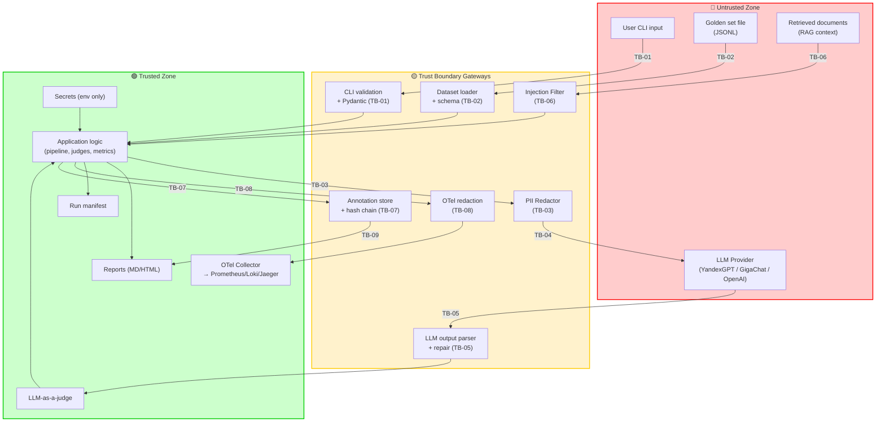

# Threat Model: Regulated LLM Eval Framework

## 1. Выбор методологии

- **Выбрано:** **STRIDE + OWASP Top 10 for LLM (комбинированно)**.
- **Обоснование:** Согласно правилам выбора (шаг 4.1), если `ai` непусто **и** присутствуют PII/регуляторика → комбинированная методология. В `security_context`:
  - `ai: ["LLM-as-a-judge", "RAG-evaluation", "prompt-injection-surface", "tool-calling-in-adapters"]` — непусто;
  - `regulatory: ["152-ФЗ"]`, `assets: ["PII", ...]` — присутствует приватность;
  - `assets: ["API-keys (YandexGPT, GigaChat)"]` — классические секреты;
  - есть внешние интеграции (LLM-провайдеры) и файловые артефакты (golden set, аннотации).

  STRIDE покрывает классические угрозы (Spoofing, Tampering, Repudiation, Information Disclosure, Denial of Service, Elevation of Privilege) для CLI/адаптеров/файлов. OWASP LLM покрывает AI-специфику: prompt injection (LLM01), insecure output handling (LLM02), training data poisoning (LLM03 — релевантно для golden set), model DoS (LLM04), supply chain (LLM05), sensitive info disclosure (LLM06), insecure plugin design (LLM07 — релевантно для адаптеров), excessive agency (LLM08 — релевантно для tool-calling), overreliance (LLM09), model theft (LLM10 — низкий приоритет, open-source).

- **Отвергнутые альтернативы:**
  - **LINDDUN** — покрывает приватность глубже, но не покрывает AI-специфику (prompt injection, excessive agency). Используется частично: элементы LINDDUN (Linkability, Identifiability) учтены в разделе PII.
  - **PASTA / OCTAVE** — избыточны для greenfield CLI-инструмента, ориентированы на enterprise risk-assessment с бизнес-метриками.
  - **MITRE ATT&CK** — ориентирован на APT/adversarial-модель, не применим к локальному eval-инструменту.
  - **Baseline** — недостаточно: есть PII и AI-компоненты.

- **Скоуп:**
  - CLI (`regulated-eval`) и library API.
  - Адаптеры YandexGPT / GigaChat / OpenAI-compatible.
  - PII-redactor, injection filter, secrets.
  - Judge (LLM-as-a-judge) и калибровка.
  - Human-in-the-loop (Streamlit + annotation_store).
  - Golden set и манифесты прогонов.
  - OTel-инструментация и экспорт телеметрии.

  **Вне скоупа:** LLM-провайдеры (внешние, вне нашего контроля), ОС и сеть, Streamlit как библиотека, presidio как библиотека (supply chain — отдельный процесс).

## 2. Активы и классификация данных

| Актив | Класс данных | Компонент | Владелец |
|---|---|---|---|
| Golden set (вопросы + эталоны) | internal (IP) | datasets → judges | data-team |
| PII в вопросах/ответах (ФИО, ИНН, СНИЛС, паспорт, телефон, email, адрес) | **PII** | datasets → security.pii_redactor → adapters → LLM | security-team |
| Экспертные аннотации | internal + **PII** (annotator_id) | human_loop.annotation_store | data-team |
| API-ключи YandexGPT / GigaChat / OpenAI | **secret** | security.secrets → adapters | infra-team |
| Промпты judge (system prompt, few-shot) | internal (IP) | judges.prompts | ai-team |
| Run manifest (содержит run_id, dataset_version, cost) | internal | datasets.manifest | product-team |
| OTel-телеметрия (спаны, метрики, audit-логи) | internal + **PII-риск** (если PII попадёт в атрибуты) | observability | sre-team |
| Retrieved-документы (RAG-контекст) | untrusted | security.injection_filter → judges | security-team |

## 3. Границы доверия (Trust Boundaries)

| ID | Граница | Откуда → Куда | Контроль безопасности |
|----|---------|---------------|----------------------|
| TB-01 | User input (CLI) → Application | untrusted → trusted | Pydantic-валидация аргументов, allowlist команд, отказ при неизвестных флагах |
| TB-02 | Golden set (file) → Application | untrusted → trusted | Pydantic-схема (FR-001), content hash (FR-002), валидация `expert_validated` |
| TB-03 | PII redactor → LLM adapter | trusted → trusted (но outgoing) | PII-redaction (NFR-SEC-002), provider allowlist (NFR-SEC-001) |
| TB-04 | Application → LLM Provider (external) | trusted → untrusted | HTTPS, `traceparent` injection, secrets из env, cost tracking |
| TB-05 | LLM output → Judge / Metrics | untrusted → trusted | Парсинг JSON со schema validation, retry с repair-промптом (FR-004), пометка `judge_status=parse_error` |
| TB-06 | Retrieved docs → RAG context | untrusted → trusted | Allowlist доменов + эвристики (NFR-SEC-003), `injection.suspected` audit |
| TB-07 | Streamlit UI → annotation_store | untrusted → trusted | Аутентификация эксперта (в v1 — локальный запуск), hash-цепочка (NFR-SEC-005) |
| TB-08 | Application → OTel Collector | trusted → trusted | Redaction PII в атрибутах спанов/логов (NFR-SEC-002), запрет secrets в атрибутах (NFR-SEC-004) |
| TB-09 | Annotation store → Reports | trusted → trusted | Аннотации только через `annotation_store`, прямые правки файлов не допускаются |

## 4. Визуализация потоков данных (цветовая кодировка)

**Легенда:**
- 🟢 **Trusted** — компоненты под нашим контролем
- 🔴 **Untrusted** — внешние источники ввода
- 🟡 **Boundary / Gateway** — точки пересечения границ

## 5. Матрица угроз

> Колонки «Категория» и «ID»: **STRIDE + OWASP LLM** — обе колонки.
> **Risk Scoring:** Risk = Likelihood (1–5) × Impact (1–5). Max = 25.
> **Top-3** — угрозы с наивысшим Risk для immediate mitigation.

| ID | Категория (STRIDE / OWASP LLM) | Угроза | Вектор | Актив | TB | L | I | Risk | Контроль | Requirement |
|----|-------------------------------|--------|--------|-------|----|---|---|------|----------|-------------|
| TM-01 | **T** / **LLM01** | Prompt Injection через retrieved-документы | Вредоносный retrieved-документ переопределяет инструкции judge/generator | Retrieved docs, промпты | TB-06 | 5 | 3 | **15** | Allowlist доменов + эвристики + LLM-проверка при сомнении | NFR-SEC-003 |
| TM-02 | **I** / **LLM06** | Sensitive Info Disclosure — PII утекает в LLM-провайдера | PII в промпте отправляется в YandexGPT/GigaChat/OpenAI без redaction | PII | TB-03, TB-04 | 4 | 4 | **16** | PII-redaction + provider allowlist + audit-лог redaction | NFR-SEC-002, NFR-SEC-001 |
| TM-03 | **I** / **LLM06** | Secrets в логах/спанах/отчётах | API-ключ попадает в лог/манифест/спан из-за ошибки логирования | API-keys | TB-04, TB-08 | 3 | 5 | **15** | Маскирование `***`, secrets только из env, тест TC-SEC-004 | NFR-SEC-004 |
| TM-04 | **T** / **LLM02** | Insecure Output Handling — judge возвращает невалидный JSON / эксплойт | Судья возвращает JSON с инъекцией (например, `__proto__` или гигантский payload) | Judge output | TB-05 | 3 | 3 | **9** | Pydantic-валидация ответа судьи, ограничение размера, retry с repair | FR-004 |
| TM-05 | **T** / **LLM03** | Data poisoning golden set | Некорректный/вредоносный golden set искажает метрики | Golden set | TB-02 | 3 | 4 | **12** | Pydantic-схема, content hash, `expert_validated`, аудит изменений | FR-001, FR-002 |
| TM-06 | **E** / **LLM08** | Excessive Agency адаптеров | Адаптер (особенно OpenAI-compatible с tool-calling) получает больше прав, чем нужно | API-keys, внешние вызовы | TB-04 | 2 | 4 | **8** | Least-privilege адаптеры, запрет tool-calling в v1, явный opt-in для foreign provider | NFR-SEC-001 |
| TM-07 | **D** / **LLM04** | Model DoS — прогон «зависает» из-за медленного провайдера | Провайдер отвечает > 5s или rate-limit 100% | Availability | TB-04 | 4 | 3 | **12** | Timeout, retry с backoff, `degraded`-статус, alert `rate_limit.high`, SLO judge p95 ≤ 5s | NFR-002, NFR-008 |
| TM-08 | **S** / — | Spoofing — подмена провайдера / MITM | Адаптер обращается к поддельному эндпоинту YandexGPT | API-keys, LLM output | TB-04 | 2 | 5 | **10** | HTTPS, pinning публичного ключа провайдера (где возможно), allowlist доменов провайдеров | NFR-SEC-001 |
| TM-09 | **R** / — | Repudiation — эксперт отрицает, что разметил запись | Нет неизменяемого audit-лога аннотаций | Экспертные аннотации | TB-07 | 3 | 3 | **9** | Hash-цепочка + audit-лог `annotator_id`, `timestamp`, `hash` | NFR-SEC-005 |
| TM-10 | **T** / — | Tampering — подмена аннотации / манифеста | Прямая правка файлов annotation_store или manifest | Экспертные аннотации, manifest | TB-07, TB-09 | 3 | 3 | **9** | Hash-цепочка, audit-лог, отклонение при расхождении hash | NFR-SEC-005 |
| TM-11 | **I** / **LLM06** | PII в OTel-атрибутах | PII попадает в атрибуты спанов/логов (например, в `record.id` или `question`) | OTel telemetry | TB-08 | 3 | 4 | **12** | Redaction middleware для OTel, allowlist атрибутов, тест TC-SEC-002 | NFR-SEC-002 |
| TM-12 | **T** / **LLM05** | Supply chain — вредоносная зависимость (presidio, streamlit, LLM SDK) | Компрометация pip-пакета | Весь стек | — | 2 | 5 | **10** | `pip-audit` в CI, lock-файл, Dependabot, минимальный набор зависимостей | NFR-009 (CI) |
| TM-13 | **I** / **LLM09** | Overreliance — пользователь доверяет eval-результатам без калибровки | Judge не калиброван (kappa < 0.6), но отчёт публикуется | Reports, метрики | — | 4 | 3 | **12** | Обязательная калибровка, статус PASS/FAIL в отчёте, порог в манифесте | FR-005 |
| TM-14 | **E** / — | Elevation of Privilege через CLI-флаги | Пользователь передаёт `--allow-foreign-provider` без понимания последствий → PII уходит за рубеж | PII | TB-01, TB-03 | 3 | 4 | **12** | Явное подтверждение (`--i-understand-152fz`), предупреждение в stderr, audit-лог | NFR-SEC-001 |
| TM-15 | **D** / — | Denial of Service — гигантский golden set / OOM | golden set 10M записей исчерпывает память | Availability | TB-02 | 2 | 3 | **6** | Лимит размера (NFR-004, ≤ 5000 записей), streaming-режим, early-exit | NFR-004 |

### Top-3 для immediate mitigation

1. **TM-02 (Risk 16, Critical)** — Sensitive Info Disclosure: PII утекает в LLM-провайдера → **NFR-SEC-002 + NFR-SEC-001**, P0.
2. **TM-01 (Risk 15, Critical)** — Prompt Injection через retrieved-документы → **NFR-SEC-003**, P0.
3. **TM-03 (Risk 15, Critical)** — Secrets в логах/спанах/отчётах → **NFR-SEC-004**, P0.

**Дополнительно P1 (Risk 12):** TM-05 (data poisoning golden set), TM-07 (model DoS), TM-11 (PII в OTel), TM-13 (overreliance без калибровки), TM-14 (EoP через флаг foreign provider).

## 6. Требования безопасности (→ в spec.md и design.md)

| Requirement | Описание | Покрывает TM | Метрика / verify |
|-------------|----------|--------------|------------------|
| NFR-SEC-001 | Provider allowlist: YandexGPT/GigaChat разрешены, OpenAI-compatible — только с явным opt-in (`--allow-foreign-provider` + `--i-understand-152fz`) | TM-02, TM-06, TM-08, TM-14 | 100% прогонов с foreign provider имеют оба флага; тест TC-SEC-001 |
| NFR-SEC-002 | PII-redaction до LLM: ≥ 99% recall на тестовом наборе из 100 записей; audit-лог без значений | TM-02, TM-11 | 100% исходящих промптов проходят redaction; тест TC-SEC-002 |
| NFR-SEC-003 | Prompt-injection фильтр retrieved-документов: ≥ 95% блокировки на тестовом наборе из 50 инъекций | TM-01 | ≥ 48/50 инъекций блокированы; тест TC-SEC-003 |
| NFR-SEC-004 | Secrets никогда не попадают в логи/отчёты/манифесты/спаны | TM-03 | 0 вхождений API-ключей в артефактах; тест TC-SEC-004 |
| NFR-SEC-005 | Целостность экспертных аннотаций: неизменяемый audit-лог с hash-цепочкой | TM-09, TM-10 | 100% аннотаций имеют hash; при подмене — `annotation.tamper`; тест TC-SEC-005 |

## 7. Влияние на ADR

> Какие архитектурные решения должны быть приняты/пересмотрены по итогам TM. Служит входом для следующего шага `adr`.

- **ADR-кандидат 1:** Выбор PII-redaction стека (presidio vs кастомный regex-набор для РФ) — влияет на NFR-SEC-002, размер wheel, latency. → ADR-001.
- **ADR-кандидат 2:** Паттерн provider allowlist и opt-in для foreign provider (`--allow-foreign-provider` + `--i-understand-152fz` vs только env-флаг) — влияет на NFR-SEC-001, UX CLI. → ADR-002.
- **ADR-кандидат 3:** Стратегия валидации вывода судьи (Pydantic + repair-retry vs строгий fail) — влияет на FR-004, TM-04. → ADR-003.
- **ADR-кандидат 4:** OTel-инструментация — auto + manual с redaction-middleware vs полностью manual — влияет на NFR-OBS-001..005, TM-11. → ADR-004.
- **ADR-кандидат 5:** Хеш-цепочка аннотаций (собственная реализация vs готовый append-only log) — влияет на NFR-SEC-005, TM-09, TM-10. → ADR-005.

> **Правило:** каждый ADR, затрагивающий безопасность, обязан ссылаться на ≥ 1 TM-NNN. Все 5 ADR-кандидатов удовлетворяют этому правилу.

## 8. Сводка для context.md

- **Методология:** STRIDE + OWASP Top 10 for LLM (комбинированно).
- **Ключевые угрозы:**
  - TM-01 (Risk 15, Critical) — Prompt Injection через retrieved docs → NFR-SEC-003
  - TM-02 (Risk 16, Critical) — PII утечка в LLM → NFR-SEC-002, NFR-SEC-001
  - TM-03 (Risk 15, Critical) — Secrets в логах/спанах → NFR-SEC-004
  - TM-05 (Risk 12, High) — Data poisoning golden set → FR-001, FR-002
  - TM-07 (Risk 12, High) — Model DoS → NFR-002, NFR-008
  - TM-11 (Risk 12, High) — PII в OTel-атрибутах → NFR-SEC-002
  - TM-13 (Risk 12, High) — Overreliance без калибровки → FR-005
  - TM-14 (Risk 12, High) — EoP через флаг foreign provider → NFR-SEC-001
- **Trust Boundaries:** 9 (TB-01..TB-09), визуализированы с цветовой кодировкой.
- **Вход для ADR:** 5 кандидатов (ADR-001..ADR-005).